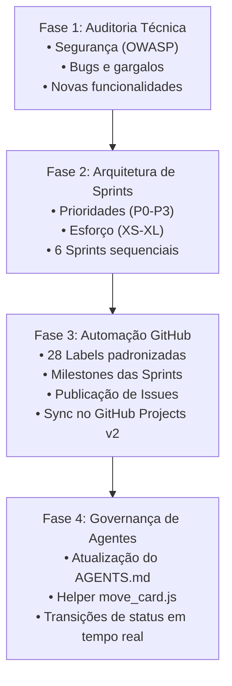

# Repo Architect & Automated Kanban Skill

Esta skill guia o agente no ciclo completo de transformação de qualquer repositório em um ecossistema estruturado de desenvolvimento com auditoria técnica, planejamento de sprints e automação de Kanban no GitHub.

## 🔄 Fluxo de Execução em 4 Fases



---

## 📌 Fase 1: Auditoria Técnica do Repositório

Quando solicitado a analisar um projeto, o agente deve examinar:

1. **Configuração e Bootstrap:**
   - Variáveis de ambiente (`.env.example`, validação de env, secrets).
   - Segurança HTTP (Helmet, CORS, Trust Proxy, Rate Limit).
   - Documentação de API (Swagger/OpenAPI exposto indevidamente em produção).

2. **Segurança (Checklist OWASP):**
   - **Controle de Acesso:** Rotas que deveriam ser restritas a admin/autor mas aceitam qualquer usuário autenticado.
   - **Vazamento de PII:** Endpoints de busca/perfil que retornam hashes, e-mails ou dados cadastrais completos para terceiros.
   - **Injeção e XSS:** Interpolação de HTML sem escape em e-mails e ausência de sanitização em payloads de rich-text/markdown.
   - **Autenticação:** Rotação de tokens, ataques de temporização (timing attacks), limitação de tentativas de login.

3. **Qualidade de Código e Bugs:**
   - Consultas com problemas de lógica (operadores OR indevidos em filtros combinados).
   - Problemas de performance e N+1 queries em relacionamentos.
   - Despejo de payloads pesados em listagens paginadas (falta de resumos/excerpts).

4. **Novas Funcionalidades Relevantes:**
   - Conteúdo e SEO (Slugs amigáveis, Feeds RSS, Sitemap, Capa).
   - Engajamento (Curtidas, salvos, notificações, perfis públicos).
   - Moderação e Administração (Denúncias, suspensão, métricas, trilha de auditoria).
   - Performance (Cache Redis, filas assíncronas com BullMQ, paginação por cursor).

O agente deve consolidar a auditoria em um artefato `analise_<projeto>.md`.

---

## 📌 Fase 2: Planejamento de Sprints & Milestones

Divida o backlog nas 6 Sprints sequenciais padronizadas:

- **Sprint 1 (P0 — Crítica):** Falhas de segurança imediatas, quebras de controle de acesso e correções lógicas de busca.
- **Sprint 2 (P1 — Alta):** Robustez, sanitização, consistência criptográfica, observabilidade e eliminação de N+1.
- **Sprint 3 (P1/P2 — Média):** Conteúdo, SEO, slugs, tempo de leitura e visibilidade pública.
- **Sprint 4 (P2 — Média):** Engajamento comunitário, notificações in-app e newsletter.
- **Sprint 5 (P2/P3):** Moderação, governança, auditoria, 2FA e múltiplos dispositivos/sessões.
- **Sprint 6 (P3 — Baixa/Escala):** Cache distribuído, filas assíncronas e otimizações de banco.

---

## 📌 Fase 3: Automação no GitHub e GitHub Projects (Kanban)

### 1. Criar Taxonomia de Labels
Utilize os seguintes padrões:
- **Prioridade:** `priority: P0`, `priority: P1`, `priority: P2`, `priority: P3`.
- **Esforço:** `effort: XS`, `effort: S`, `effort: M`, `effort: L`, `effort: XL`.
- **Tipo:** `type: security`, `type: bug`, `type: feature`, `type: improvement`, `type: refactor`, `type: epic`, `type: tracking`.
- **Área:** `area: auth`, `area: users`, `area: posts`, `area: comments`, `area: categories-tags`, `area: security-infra`, `area: notifications-mail`, `area: seo-feed`, `area: admin-moderation`, `area: performance`.
- **Status:** `status: backlog`, `status: pronto para iniciar`, `status: em andamento`, `status: em revisão`, `status: concluído`.

### 2. Criar Milestones
Crie uma milestone no GitHub para cada uma das 6 Sprints para agrupar as entregas.

### 3. Publicar as Issues
Cada issue deve conter obrigatoriamente:
- Origem
- Contexto e problema
- Objetivo
- Escopo
- Checklist de implementação
- Critérios de aceite
- Validação
- Prioridade e Esforço estimado
- Referências técnicas

### 4. Sincronizar com GitHub Projects v2
1. Obtenha o token com escopo `project` e `repo` via `.env` (`GITHUB_TOKEN`).
2. Adicione todos os itens ao projeto via GraphQL (`addProjectV2ItemById`).
3. Mantenha no status **`Ready`** apenas as tarefas da **Sprint atual (Sprint 1)**.
4. Mantenha todas as tarefas futuras no status **`Backlog`**.
5. Preencha os campos nativos de `Priority` e `Size` do Project.
6. Crie a **Issue Mestre de Rastreabilidade** (`[BACKLOG MESTRE]`) com links e tabelas de todas as tarefas.

---

## 📌 Fase 4: Governança de Agentes (`AGENTS.md`) e Ciclo de Execução

Ao configurar o projeto para desenvolvimento autônomo (Vibecoding):

1. **Atualize o arquivo `AGENTS.md`** na raiz do projeto com as diretrizes de sincronização do Kanban em tempo real:
   - Ao iniciar a tarefa ➔ mover para `In progress` (`status: em andamento`).
   - Ao rodar os testes ➔ mover para `In review` (`status: em revisão`).
   - Ao passar nos testes ➔ comitar com `closes #N`, mover para `Done` (`status: concluído`) e fechar a issue.

2. **Gere o helper `scratch/move_card.js`** que lê `GITHUB_TOKEN` do `.env` e permite transitar qualquer issue via linha de comando:
   ```bash
   node scratch/move_card.js <NUMERO_DA_ISSUE> <STATUS> "<COMENTARIO>"
   ```
   *Status aceitos:* `backlog`, `ready`, `in_progress`, `in_review`, `done`.

3. **Proteja o segredo:** Assegure que `.env` e `/scratch` estejam no `.gitignore`.
